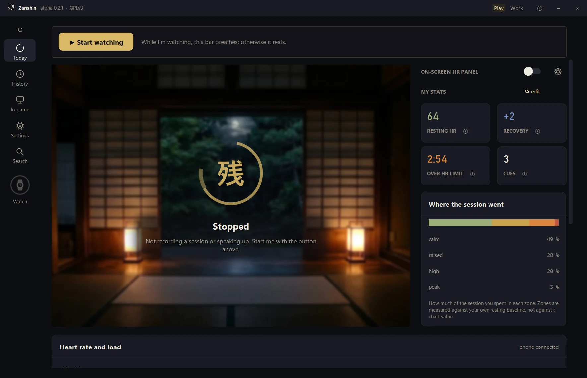
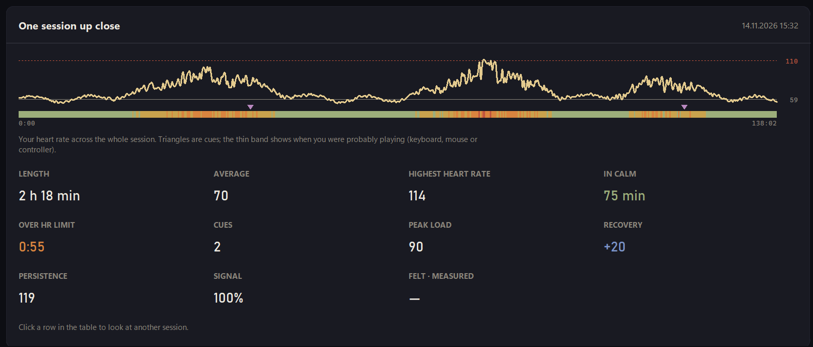

# 残 Zanshin

*Alpha 0.3 · Windows · code under GPLv3*

**A free, open-source Windows app for gamers. When your heart rate shows
you've been under strain for a while, Zanshin waits for a short lull in your
input and gives you a calm cue: breathe out, unclench your jaw, loosen your
grip.**

**You need:** Windows 11 64-bit (Windows 10 untested) · a smartwatch that
measures heart rate, with its companion phone app that sends the heart rate to
this PC (tested: a Samsung Galaxy Watch7 with an Android phone and *HeartRateOnStream
for OBS*, free) · the phone and the PC on the same home network (Wi‑Fi).

[Download](https://github.com/Dandurfin/Zanshin/releases/latest) ·
[Quick start](#quick-start) · [Pair your watch](#getting-your-heart-rate-in) ·
[Troubleshooting](#troubleshooting) · [Known issues](KNOWN_ISSUES.md) ·
[Changelog](CHANGELOG.md) · [Privacy](PRIVACY.md) · [Anti-cheat](SAFETY.md)

*Today, with synthetic data. This page describes 0.3; the 0.2.1 ZIP still
uses some older names and lacks some controls
([what changed](CHANGELOG.md#what-03-changes)).*

**Local-first.** Your heart rate, sessions and insights never leave your PC.
No account, no telemetry, no analytics. One exception is on by default: the
natural voice sends Microsoft the wording of your spoken cues, to turn it into
speech — never your heart rate — and, like any connection, your IP address.
Nothing new is prepared while Zanshin is watching. To keep even that local,
pick *Windows (offline)* under Settings → Sound → *Voice source*. Only when
you click **Update voice** (from 0.3) does Zanshin download newer code for
that voice from PyPI, the Python package index, and test it with one word.
Once you start pairing a watch, the heart-rate port (`4455`) is open whenever
Zanshin runs and accepts connections without a password from every network
your PC is on, so allow Zanshin on your home network only.
Everything that can use the network is in [PRIVACY.md](PRIVACY.md). Zanshin is
not a medical device.

**Anti-cheat-friendly.** No keyboard hook, no injection, no reading of game
memory or the screen, no simulated input, no administrator rights. Outside its
own window Zanshin learns only the time since your last input (not which key),
controller activity while it's watching, where the foreground window and the
mouse pointer are, your monitors, keyboard layouts and this PC's network
adapters and addresses, and — with automatic profile switching on, the
default — the names of running programs. The microphone is used only while
you record your own cue. While Zanshin runs it reserves one shortcut for "not
now" (no cues for 30 minutes; Ctrl+Alt+Z by default), so a game that uses it
may not receive it. Full list: [SAFETY.md](SAFETY.md) (in
Slovak, with an English summary at the top). Only an anti-cheat's maker can
promise it won't flag you.

## Quick start

1. Download the ZIP, check its fingerprint and unpack it (see
   [Install](#install)), then start `Zanshin.exe`.
2. Go through the short introduction.
3. Pair your watch: [five steps](#getting-your-heart-rate-in).
4. Play. On the very first start Zanshin starts watching by itself after the
   introduction (from 0.3 it first waits for the natural voice, at most about
   15 seconds; *Today* shows *Preparing the voice*). After that it starts by
   itself whenever Apex Legends, Call of Duty, CS2 or Valorant is running
   (automatic profile switching, on by default); otherwise press
   **▶ Start watching** at the top of *Today*.
5. After a session, answer the few questions if you like: that's how Zanshin
   learns when to go quieter.

The first time you close the window, Zanshin asks: **Keep running in the
tray** or **Quit Zanshin**. After that × only hides it there (on Windows 11
the icon is often under the ^ arrow by the clock). To quit: right-click the
tray icon → **Quit**.

## Install

**Official source:** only <https://github.com/Dandurfin/Zanshin>. There are two
ways to get Zanshin, and both start there. If anyone offers you a ready-made
Zanshin `.exe` or installer anywhere else, it isn't from me. There is no
installer: you unpack a ZIP, or you build the app yourself.

**Why no signature:** Windows warns about programs downloaded from an "unknown
publisher", which is what an app without a code-signing certificate is. A
certificate Windows trusts would put my legal name into every copy of the file,
so Zanshin has none. The fingerprint below proves the ZIP is mine and
unchanged; it doesn't make the warning go away.

### A. Ready-made ZIP (easiest)

0. **Had the 0.2 installer?** It shares your data folder with this ZIP. When
   you uninstall it, answer **Yes** to *Keep your settings…* — **No** deletes
   `%APPDATA%\Zanshin`, which this version uses too.
1. On the GitHub page open
   [**Releases**](https://github.com/Dandurfin/Zanshin/releases/latest) and
   download `Zanshin-<version>-windows.zip` (for this version
   `Zanshin-0.3-windows.zip`, about 59 MB). The release lists the file's
   **SHA-256** fingerprint.
2. Check it. In File Explorer open the folder with the ZIP, click the address
   bar, type `powershell` and press Enter. In the window that opens, run this
   with the fingerprint from the release pasted in:
   `(Get-FileHash .\Zanshin-0.3-windows.zip).Hash -eq 'PASTE-THE-HASH-HERE'`.
   It must print **True** (upper or lower case doesn't matter). If it prints
   **False**, delete the file.
3. Unpack it (right-click → **Extract All…**) into a folder OneDrive doesn't
   sync, for example `C:\Games`. OneDrive would upload the whole app and can
   make its files online-only, and then Zanshin may fail to start. Start
   `Zanshin\Zanshin.exe`. The first time, Windows shows "Windows protected your
   PC": choose **More info → Run anyway**, only for a ZIP whose fingerprint
   matched. Keep the whole `Zanshin` folder together: the `.exe` needs the
   `_internal` folder next to it.

To update, quit Zanshin, delete the old folder and unpack the new ZIP the same
way; your data stays (see *Your data* below).

### B. Build it yourself (no "unknown publisher" warning for Zanshin.exe)

A program you build on your own PC wasn't downloaded, so Windows doesn't show
the "unknown publisher" warning for it. Zanshin's own code is then exactly what
you can read here. The libraries it uses (`requirements.txt`) and PyInstaller,
which packs it into an `.exe`, come from PyPI, the usual Python package index.
The build installs the ones that are missing, in whatever version is newest
that day, and keeps using the ones already installed without updating them, in
later builds too. The one exception, from 0.3, is `edge-tts`, the library
behind the natural voice: every build fetches its newest version, because
when Microsoft changes something on its side, the fix usually comes in a new
`edge-tts`. pip then updates a library `edge-tts` itself uses only if the new
version needs a newer one. The build then checks that Zanshin can still call
the new `edge-tts` (if not, it stops and says how to go back to the last one
that worked) and, online, has it say one test word through Microsoft. If
Microsoft refuses it, a yellow warning says so and the build goes on: the
Windows voice covers the cues until **Update voice** in the app or a later
build fixes it. Offline, the build keeps the `edge-tts` you have if it's new
enough (`edge-tts` 7.3.1 or newer; Microsoft refuses older ones) and says it
couldn't check; with an older one it stops.

This is how I install it myself. You need an internet connection. On my PC
the first build downloaded under 100 MB and took about 550 MB on disk, Python
included.

1. **Install Python.** On <https://www.python.org/downloads/> click
   **Download Python install manager**, open the downloaded file and click
   **Install**. It needs no administrator rights and there's nothing to tick.
   You don't have to pick a Python version: the first build (step 3) fetches
   the newest Python 3 by itself. I build and test with Python 3.14. Anything
   newer is untested, and until the libraries and PyInstaller support it, the
   build may stop at a red **ERROR:** line. If you already have Python 3.10 or
   newer, you can skip this step, but only 3.14 is tested.
2. **Get the source.** On the GitHub page open **Tags** and, next to the
   newest version, click **zip**. Before unpacking, right-click the ZIP →
   **Properties** → tick **Unblock** → **OK**. Windows marks everything you
   download, and without this it shows an "unknown publisher" warning for
   `build.bat` in step 3. Unblock only a ZIP you got from the page above. Then
   right-click the ZIP → **Extract All…** and choose a folder that OneDrive
   doesn't back up, for example `C:\Games` (Desktop and Documents often are in
   OneDrive). You get a folder like `Zanshin-0.3`; if there's another folder
   of the same name inside it, open that one too, until you see `build.bat`.
3. **Build it.** Double-click **`build.bat`** (with file extensions hidden, it
   shows as `build`). The first time, it fetches Python through the install
   manager, the packages Zanshin needs and PyInstaller, then builds the app;
   on my PC that took about 3 minutes, and for a while the window shows
   nothing new. A lot of text from pip and PyInstaller scrolls past,
   including WARNING lines about PATH: that's normal. Near the end a yellow
   line says *Inno Setup not found - installer not built (it isn't needed).*
   That's expected. Then a green line, *DONE: the app is
   dist\Zanshin\Zanshin.exe - just run it.*, says where the app is; press any
   key to close the window. If it stops at a red line starting **ERROR:**,
   the rest says what went wrong: *Python not found* means Python isn't there
   or couldn't be downloaded, *pip install failed.* means the packages
   couldn't be downloaded or installed. Check your connection and step 1,
   then run `build.bat` again; if it still fails, please open an issue and
   paste the last lines.
4. **Start it.** In the same folder, open `dist`, then `Zanshin`: the app is
   `dist\Zanshin\Zanshin.exe`. For a desktop shortcut, right-click it → on
   Windows 11 **Show more options** → **Send to → Desktop (create shortcut)**.
   Keep the whole `dist\Zanshin\` folder together: the `.exe` needs the
   `_internal` folder next to it. When Zanshin first opens its heart-rate
   port, Windows Firewall may ask whether to allow it; see *Getting your heart
   rate in* below.

### Both ways

**If Windows blocks it:** antivirus programs, Windows Security included,
sometimes flag programs packed with PyInstaller by mistake. The build is a
folder rather than one self-unpacking `.exe`, and UPX compression is off; both
are often blamed for these false alarms, but I can't promise it won't happen.
And with Smart App Control on (Windows Security → App & browser control),
Windows can block unsigned programs outright, with no "Run anyway". I haven't
been able to test how it treats the ZIP or a Zanshin you built yourself. If
either happens, please don't switch your protection off for Zanshin; open an
issue instead, so I know.

**Updating a Zanshin you built:** quit Zanshin first (right-click its tray
icon → **Quit**). If it's still running, `build.bat` closes it without asking,
and a session in progress isn't saved (from 0.3 the next start adds it to
your history from the copy Zanshin keeps every 5 minutes, without its last few
minutes). Then get the new version and build it the same way. Your data stays,
because it isn't in the build folder. Make a new shortcut to the new
`dist\Zanshin\Zanshin.exe` and delete the old folder. To Windows Firewall it's
a new program, so it may ask again.

**Your data** (settings, heart-rate history, recordings, prepared voice and
sounds) lives in `%APPDATA%\Zanshin`, not in the app's folder, so neither a new
ZIP nor rebuilding touches it. From 0.3, shutting Windows down saves a
session in progress, a running session is also copied every 5 minutes, a
session that can't be saved is kept aside for the next start, your settings
keep a backup copy, and **Open the data folder** under Settings → General →
*Your data* opens that folder; details in [CHANGELOG.md](CHANGELOG.md).

**No administrator rights,** not for Python's install manager, not for the
build, not for the app, and don't run Zanshin as administrator. The app draws
a window over the game, and I don't want an elevated process doing that,
because anti-cheats (Vanguard, EAC, VAC) may treat it more harshly; only their
makers know what they actually check. The one exception is Windows Firewall's
own question when Zanshin first opens its heart-rate port: allowing an app
there takes administrator approval, because it changes a Windows setting.

## Getting your heart rate in

Zanshin has no app of its own on the phone. It takes heart rate from a
companion app made by someone else, which runs on your phone and watch and
sends the number straight to this PC.

| Your watch | Companion app | Status |
|---|---|---|
| Wear OS watch with an Android phone | *HeartRateOnStream for OBS* (free) | Tested by me on a Samsung Galaxy Watch7 |
| Apple Watch with an iPhone | *PulseOSC* (paid) | Untested: I have no Apple device |
| Garmin, Fitbit and others | An app that sends heart rate straight to this PC over OSC, plain UDP (a bare number or simple JSON) or obs-websocket (the number written into a text source) | Untested |

Cloud services (Pulsoid, HypeRate, Stromno) don't work with Zanshin: they route
your heart rate through their own servers, and Zanshin only takes heart rate
sent straight to this PC.

1. **Same Wi‑Fi.** Phone and PC on the same Wi‑Fi: not mobile data, not a
   guest network, VPN off.
2. **Install the companion app** on your phone and watch: for Android / Wear
   OS *HeartRateOnStream for OBS* (free). Its store link is the QR code under
   *Scan with your phone* in **In-game → Watch and heart rate**. iPhone: see
   below.
3. **Open the pairing guide:** **How to pair your watch…** in that panel, or
   the watch icon in the sidebar. This switches heart-rate receiving on. If
   Windows Firewall asks now, allow Zanshin on **private networks** only, and
   check that your home network is private itself: Settings → Network &
   internet → Wi‑Fi (or Ethernet) → your network → *Network profile type*:
   *Private network*.
4. **Enter the address.** Click **Show IP** in the guide and type the address
   and port it shows into the phone app, not the `0.0.0.0` from the *Network
   address (advanced)* field. Leave the password empty.
5. **Pick the scene and source.** In the phone app pick the scene "Zanshin"
   and the source "Tep". Within seconds *Today* shows your heart rate (from
   0.3 the guide does too, under the address).

**Still waiting for the watch?** If the phone hasn't connected after about 20
seconds, *Today* and the guide say so (from 0.3), and the guide's *Watch
won’t connect at all?* box lists what to check. The usual causes: **Cancel**
in Windows Firewall's question (fix: Windows Security → Firewall & network
protection → Allow an app through firewall → Change settings → tick
**Private** next to Zanshin), a network set to Public (step 3), a guest Wi‑Fi
or the router's "client isolation", which keeps devices apart, or a VPN (from
0.3 the guide marks a VPN's address *(VPN/virtual)*). After a router
restart the PC can get a new address: check the one in the phone again.

**Streaming with OBS?** OBS Studio's own WebSocket server also uses port
`4455`. While it holds the port, Zanshin can't open it: its log says so, and
from 0.3 *Today* shows *Port 4455 is busy*. Change **Port** in **In-game →
Watch and heart rate**, for example to `4456`, and enter the same number in
the phone app; Zanshin tries the new port right away. You don't need OBS for
Zanshin.

**iPhone / Apple Watch:** *PulseOSC* (paid) sends OSC, which Zanshin's code
can receive — **but the iPhone route is untested so far: I have no Apple
device.** PulseOSC costs money, so keep that in mind before you buy it;
if you try it, please let me know whether it works for you (open an issue).
The password, scene and source steps in the app's pairing guide apply to the
Android app only; in PulseOSC you only enter this PC's IP and port.

**Android / Wear OS:** the free version of *HeartRateOnStream for OBS* sends
heart rate only; steps, which Zanshin uses to stay quiet while you walk, come
only from its premium version.

**The companion is someone else's app.** The QR codes in Zanshin are just
download links to it (they open the App Store / Google Play). Zanshin can't
vouch for what the companion does on its own side, so pick one you trust.

**What the port does.** Zanshin **listens on port `4455`** (TCP and UDP) so a
phone or watch app can push readings to it. It replies only as much as the
connection needs (on TCP it pretends to be OBS) and never sends your heart
rate out. The port stays closed until you switch on *Receive heart rate from
the phone* under **In-game → Watch and heart rate** or open the pairing guide
(*Pair your watch* or *How to pair your watch…*). After that it opens every
time Zanshin starts, until you switch it off. It listens on **every network
your PC is connected to** (unless you type one of this PC's own addresses into
**Network address (advanced)** in that panel; an address the PC doesn't have
falls back to all networks, and the log says so) and **without a password**,
so anything that can reach that port could send it a heart-rate value. Only
your firewall decides who can: allow Zanshin on your home network only, not on
public Wi-Fi (details in [PRIVACY.md](PRIVACY.md)).

## System requirements

- **Windows 11, 64-bit.** It's the only version I've tested. Windows 10 64-bit
  may work, but it's untested.
- **Disk and memory:** the 0.2.1 ZIP is about 59 MB to download and about
  125 MB unpacked. On my PC Zanshin used about 200 MB of RAM and about 0.6 % of
  a 20-thread CPU, roughly an eighth of one core.
- **A smartwatch and a companion app** that sends heart rate to this PC, with
  the phone and the PC on the same home network (see the table above).
- **Internet:** while you use Zanshin, only for the natural voice (optional)
  and, from 0.3, its **Update voice** button.
- **Borderless or windowed games** if you want to see the pictures. Windows
  doesn't draw them over exclusive fullscreen; the voice still plays.
- **No administrator rights.**

## What it does

- **Your body decides when.** Once your load (Zanshin's measure of strain,
  from your heart rate) has spent about 45 seconds above your threshold,
  Zanshin waits for a pause of about 2.5 s without keyboard, mouse or
  controller input, once your load has stopped climbing, and then gives you
  the cue. It can't see the game, so a still moment mid-fight can count as a
  pause too. If no such pause comes within 90 s, it shows only the picture.
  Never in the Peak zone; at most 5 cues an hour, at least 4 minutes apart.
- **It backs off when it gets in the way.** Tell it after a session that a
  cue disrupted you, or press "not now" right after one, and it goes a step
  quieter: voice → picture only → a few sessions without cues. It never gets
  louder than the style you pick (Settings → Sound → *How I speak up*).
- **It learns your numbers.** Your load threshold, resting baseline and high
  heart-rate limit come from your own sessions, at least three for each (the
  threshold and the limit only from play sessions of five minutes or more).
  Until then Zanshin uses average-player numbers. Nothing to tune by hand.
- **Play and Work.** A *Play | Work* switch in the title bar. Each world keeps
  its own history and look (*Sumi*, ink and gold; *Aizome*, indigo). At work,
  cues are pictures only.
- **Voice and sound.** The natural voice (online, Microsoft; the default) or
  the Windows voice (offline), eight built-in sounds, or your own recording.
- **In-game pictures and an optional heart-rate panel.** Click-through and
  scaled to your screen. Not over exclusive fullscreen.
- **History.** Your sessions, and slow trends such as your resting baseline,
  heart rate recovery and time over your heart-rate limit: rough trends from a
  consumer watch, not a diagnosis.
- **Guide.** A short note behind each of the four cues (Grounding, Jaw,
  Grip & gaze, Breath): what happens in the body and why it may help, with
  sources. None of those studies tested Zanshin.
- **11 languages.** Slovak is the original; the others are AI-assisted
  translations not yet checked by a native speaker.

*One session in History (synthetic data): triangles are cues, the band
under the curve shows when you were probably playing.*

The exact rules — when a cue comes, when Zanshin goes quieter, what it learns
from and when the natural voice prepares its lines — are in
[docs/HOW-IT-WORKS.md](docs/HOW-IT-WORKS.md).

## Privacy and anti-cheat

The short version is at the top of this page. In detail:

- [PRIVACY.md](PRIVACY.md) lists everything that can use the network: the
  natural voice, **Update voice** (from 0.3, only when you click it: newer
  code for the natural voice from PyPI, plus one test word to Microsoft), the
  heart-rate port, a download that happens only if a built-in sound is
  missing, and links you click. Zanshin never checks for a new version of
  itself, and logs stay in local files. Your PC's IP address stays hidden on
  screen until you click *Show IP*.
- [SAFETY.md](SAFETY.md) lists what Zanshin does next to a game and what it
  deliberately doesn't, and what **Update voice** checks before the code it
  downloads runs, and what those checks can't protect against: a compromised
  `edge-tts` project or PyPI.
- Zanshin has no Steam integration — it doesn't load the Steam SDK or talk to
  Steam in any way.

## Troubleshooting

- **The watch won't connect.** See *Still waiting for the watch?* under
  [Getting your heart rate in](#getting-your-heart-rate-in). Most often it's
  **Cancel** in Windows Firewall's question or a network set to Public.
- **OBS is running.** It holds port `4455`; see *Streaming with OBS?* above.
- ***Android can connect, iPhone (PulseOSC) can’t*** next to the switch: another
  program holds UDP port `4455`, or Windows won't open it. Zanshin keeps
  listening on TCP, so the Android route still works, but OSC and plain-UDP
  companions, PulseOSC included, can't reach it. It doesn't retry UDP by
  itself: close that program, then switch *Receive heart rate from the phone*
  off and on.
- ***Two different heart rates in one source — check the watch app*** (from
  0.3): the companion writes two heart rates into one source. In the
  companion's settings, let only the live heart rate write into the heart-rate
  source, or the second one ends up in your measurements too.
- **No pictures over the game.** Exclusive fullscreen hides them (the voice
  still plays); switch the game to borderless.
- **A cue spoke in a robotic voice.** That's the Windows voice: the natural
  voice wasn't ready for that line yet (offline, for example, or you changed
  it while Zanshin was watching). Zanshin prepares it once you stop watching.
  From 0.3, if preparing failed, the line under Settings → Sound → *Voice
  source* says why, with a *Try again* button.
- **The line under *Voice source* says Microsoft refused the request** (from
  0.3). Microsoft has probably changed something that only a newer version
  of the voice's library can handle. Click **Update voice** right below it
  (once you've stopped watching): Zanshin looks for a newer `edge-tts` on
  PyPI, checks it, tests it with one word and keeps it only if it works
  ([what it sends and stores](PRIVACY.md), [what it checks](SAFETY.md)). If it
  then says Microsoft refuses even the newest version, or that the update
  needs a newer Zanshin, get the new release from
  [Releases](https://github.com/Dandurfin/Zanshin/releases/latest); the
  **↗ New Zanshin on GitHub** link next to the button opens that page. Until
  then the Windows voice speaks the cues whose natural voice is missing.
- **Still on the 0.2.1 ZIP?** Since about November 2026 Microsoft refuses
  the natural voice's library inside it, so every new line plays in the
  Windows voice, and it has no **Update voice** button. Update to 0.3 (see
  [Install](#install)); your data stays.
- **A game's Ctrl+Alt+Z does nothing.** Zanshin reserves it for "not now".
  From 0.3, pick another shortcut or *Off* in Settings → General →
  *Keyboard shortcut*. "Not now" stays in the tray icon's menu.
- **A session you don't want in your history** (one that ran overnight, for
  example): from 0.3, History → *One session up close* → **Delete this
  session**.
- **"Windows protected your PC", your antivirus or Smart App Control blocked
  it.** See *If Windows blocks it* under [Install](#install). Please don't
  switch your protection off.

## Uninstall

1. Quit Zanshin: right-click the tray icon → **Quit** (× only hides it).
2. Optional: keep your history with Settings → General → *Your data* →
   **Export history (JSON)**.
3. Delete the unpacked folder (for example `C:\Games\Zanshin`) and your
   shortcut.
4. Delete `%APPDATA%\Zanshin` if you don't want to keep your settings,
   history and recordings.
5. Optional: remove the firewall entry. Windows Security → Firewall & network
   protection → Allow an app through firewall → Change settings → select
   *Zanshin - heart-rate companion for gamers* (there's one for each folder
   you ran Zanshin from) → **Remove**.

If you built it yourself, Python stays installed: if you don't need it for
anything else, uninstall *Python 3.x* first and then *Python install manager*,
in Settings → Apps → Installed apps. pip keeps what it downloaded for the build
in `%LOCALAPPDATA%\pip\cache` (about 45 MB on my PC); you can delete that
folder, and `%LOCALAPPDATA%\Python` too if it's still there afterwards.

## Known issues

What doesn't work yet or works only partly: [KNOWN_ISSUES.md](KNOWN_ISSUES.md).
What each version changed: [CHANGELOG.md](CHANGELOG.md).
Found something? [Open an issue](https://github.com/Dandurfin/Zanshin/issues).
Please don't post heart-rate files or logs publicly.

## Similar projects

The tools I found show your heart rate, alert you when it crosses a number you
set, or remind you at set or random times. Zanshin is the only one I could find
that reads your heart rate while you play and holds its voice for a short pause
in your input — on your own PC, and only after your strain has spent a while
above your threshold. The projects I compared it with, and what Zanshin
deliberately isn't: [docs/PRIOR_ART.md](docs/PRIOR_ART.md).

## License

| What | License | File |
|---|---|---|
| **All of the source code** — including the ensō drawn in code, the colour themes and the layout | **GNU GPL v3.0** — free and open | [`LICENSE`](LICENSE) |
| **Two artwork files** — the app icon (`Dandurf.ico`) and the dojo picture (`assets/images/dojo_noc.webp`) | © Dandurfin — they travel with unmodified copies of the official Zanshin | [`LICENSE-DESIGN.md`](LICENSE-DESIGN.md) |
| **Two sounds** — `sfx_click_reload.wav` and `sfx_lock_ping.wav` in `assets/sounds/modern` | CC0, from Kenney's *Interface Sounds* — their own terms | [`LICENSE-DESIGN.md`](LICENSE-DESIGN.md) |

You may read, run, study, change and pass on the code freely under the GPL.
A modified version has to be clearly marked as different from the original —
its own name, or a plain note that it is a modified version — and use its own
icon and picture. It must not present itself as the official Zanshin or as
made or endorsed by Dandurfin (additional terms under GPLv3 section 7; see
[`LICENSE-DESIGN.md`](LICENSE-DESIGN.md)). This is there to protect the people
who use Zanshin, not to make money.

---

Made by **Dandurfin** — [Twitch](https://www.twitch.tv/dandurfin) ·
[YouTube](https://www.youtube.com/channel/UCzZyqQfTNpiGkt_SIOmKO2w) ·
[Kick](https://kick.com/dandurfin)

Developers: running from source, tests, the build and the project structure
are in [DEVELOPMENT.md](DEVELOPMENT.md).

**[Soul of the app](SOUL.md)**
